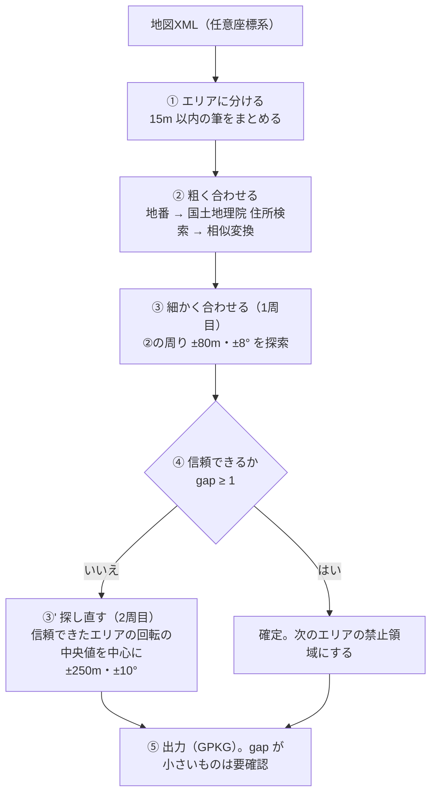

# 位置合わせの手法

任意座標系の地図XMLを、公共座標系（広島県は平面直角座標系 第III系、EPSG:6671）に合わせる方法をまとめる。
実装は `moj-georef geocode-align`（`src/moj_georef/two_stage.py`）。
当初の設計と検討の経緯は [design.md](design.md) を参照。

## 考え方

人がジオリファレンスするときと同じく、**「だいたいの場所を住所で探す」→「道路や地形の線に重ねて微調整する」** の2段階で合わせる。

- 任意座標系の筆は、形は正しいが、位置・向きが分からない（原点付近の局所座標）。
- 変換は **相似変換**（平行移動・回転・縮尺）とする。公図の歪みを直す局所補正はまだしていない。
- 全部を自動で正しく合わせることは目指さない。結果ごとに **信頼度（gap）** を出し、人が確認するものを絞る。

## ① エリアに分ける

1つの XML の中でも、図郭ごとに別の局所座標系を使っていることがある（熊野町では図郭どうしが離れていた）。
そこで、**距離 15m 以内の筆をまとめた「エリア」** を位置合わせの単位にする（`anchor.split_areas`）。

## ② 粗く合わせる：地番のジオコーディング

先行研究（梅原ほか 2024）の方法に沿う。

1. 筆の地番から本番（`215-4` なら `215`）を取り、**大字＋本番ごとに筆の重心**を求める。
2. 国土地理院の[住所検索 API](https://msearch.gsi.go.jp/address-search/AddressSearch) で
   「広島県安芸郡熊野町東山215番地」のように引き、番地の位置を得る。
   検索結果の名称が `大字＋本番＋番地` で終わるものだけを採用する。
3. 「本番ごとの重心 ↔ 番地の位置」を対応点として、**最小二乗で相似変換**を求める。
   - 外れ値（残差が Q3 + 1.5×IQR を超えるもの）を除いて再計算する（最大3回）。
   - 番地の位置は代表点に丸められていて、同じ点が何度も出てくる。同じ点に当たったものは1点にまとめる。
   - 丸めで縮尺が縮んでしまうので、**縮尺は1に固定**し、位置と回転だけを求める。

この段階の精度は数十m（熊野町の団地で RMSE 5〜130m）。場所の見当を付けるのが目的。

## ③ 細かく合わせる：向き付きチャンファーマッチング

②の結果の周りで、**筆界線が参照データの線にいちばんよく乗る位置・回転・縮尺**を探す。

### 参照データ（合わせる相手）

| データ | 使い方 | 効く場所 |
|---|---|---|
| 0.5m DEM の曲率エッジ | 曲率の大きい画素（上位10%）を線とみなす。法面・段差・道路の切土など | 山林・造成地 |
| 国土地理院 基盤地図情報の道路縁・水涯線 | [ベクトルタイル](https://github.com/gsi-cyberjapan/experimental_fgd)（z18）から取得 | 市街地・団地。**精度を大きく上げたのはこれ** |
| 周りの公共座標系の筆界 | 隣接する地区の線 | 地区の端 |

### 評価値（小さいほど良い）

- **線への近さ**：筆界線上に1m間隔で点を取り、各点から「向きが近い（±30°以内）参照線」までの距離を平均する（10mで打ち切り）。
  向きも見るのは、森林の DEM エッジのような向きのばらばらな雑音に引き寄せられないようにするため。
- **罰則**（重なってはいけない場所）
  - 公共座標系の筆や、先に確定したエリアと重なる
  - 筆の内部に地形のエッジが多い（筆の内部は平らなはず）
  - 筆界が建物（基盤地図情報の建築物外周線）の内部を通る

### 探索

1. 回転（1°刻み）と縮尺（0.98〜1.02）の組ごとに、**すべての平行移動の評価値を FFT で一度に計算**し、候補を上位5つ残す。
2. 各候補を Nelder-Mead 法で細かく最適化する（回転・縮尺は探索範囲内に制限）。
3. 評価値の最も小さいものを結果とする。

## ④ 信頼度：1位と2位の差（gap）

**gap = 2位の候補の評価値 − 1位の候補の評価値**。
1位がほかの候補より飛び抜けて良ければ、その位置は「ほかにありえない」ので信頼できる。
似た形の街区が並んでいて区別できないときは gap が小さくなる。

- 正解のある評価では、gap ≥ 0.5 の結果に誤りはなかった。運用では余裕を見て **gap ≥ 1 を「信頼できる」** とする。
- 信頼できたエリアは確定し、次のエリアの罰則（禁止領域）に加える。パズルのように、埋まった場所には次のエリアが入らない。
- 対応点（番地の点）の多いエリアから順に処理する。

### 2周目：探し直し

1周目で信頼できなかったエリアは、②の回転が外れていることが多い。
同じ時期に同じ人が作った図面は傾きが揃っているので、
**信頼できたエリアの回転の中央値**を中心に、±250m・±10° の広い範囲で探し直す。

## ⑤ 出力

`data/align/<市区町村>_geocode.gpkg`（EPSG:6671）

| レイヤー | 内容 |
|---|---|
| `aligned` | 最終結果の筆。`reliable`（信頼できるか）、`second_gap`（gap）、`theta`（回転）、`scale`（縮尺）などの属性付き |
| `aligned_coarse` | ②だけの結果 |
| `anchors` | 番地の位置（ジオコード結果） |
| `residuals` | ②の変換後の重心から番地の位置への線 |

`qgis/make_review_project.py` で、オルソ画像・CS立体図と重ねて確認する QGIS プロジェクトを作れる。

## 使用データ（熊野町の検証）

### 位置合わせの計算に使ったもの

| データ | 提供元 | 時点・仕様 | 使い道 |
|---|---|---|---|
| 登記所備付地図データ（地図XML） | 法務省（G空間情報センター） | 2026年版（`34307-2400-2026.zip`） | 任意座標系の筆（合わせる対象）、公共座標系の筆（周りの筆界・重なり禁止の領域） |
| 住所検索 API | 国土地理院 | 実行時に取得（`data/cache/gsi_geocode.json`） | ② 地番 → 番地の位置 |
| 基盤地図情報ベクトルタイル（experimental_fgd） | 国土地理院 | **2014年時点**（属性 `lfSpanFr`）、地図情報レベル2500、z18 | ③ 道路縁・水涯線を参照線に、建築物の外周線を罰則に |
| 0.5m DEM | 広島県 DoboX（航空レーザ測量から作成） | 2022年 | ③ 曲率エッジを参照線に、筆の内部の凹凸を罰則に |

### 確認だけに使ったもの（計算には使っていない）

| データ | 提供元 | 時点・仕様 | 使い道 |
|---|---|---|---|
| オルソ画像 | 広島県 DoboX | 2016年度・20cm（図郭 `qe193`） | 結果の目視確認 |
| CS立体図 | 広島県の 0.5m DEM から作成（既存のもの） | 2022年 | QGIS の背景 |

OpenStreetMap は使っていない。

### 注意：基盤地図情報ベクトルタイルの時点

experimental_fgd は2014年に始まった提供実験で、更新頻度・終了予定の記載がなく、基本測量成果でもない。
熊野町の団地は2014年より前に造成され、確認に使ったオルソ画像（2016年度）とも食い違いはなかったので、
今回の結果への影響は小さい。2014年より後に造成・建て替えされた場所では、線がない・建物がずれることになる。
ほかの地区に広げるときは、基盤地図情報ダウンロードサービス（随時更新、要利用者登録）の最新データへの切り替えを検討する。

## 精度の測り方と結果（熊野町）

### 正解のある評価

公共座標系の図郭をわざと崩し（位置をずらし、回転させる）、元に戻せるかを測った（`moj-georef evaluate`、20図郭、探索範囲 ±300m）。

| 参照データ | 成功（誤差5m未満） | 成功時の誤差（中央値） |
|---|---|---|
| DEM のみ | 5/20 | ― |
| DEM＋公共座標系の筆界 | 6/20 | ― |
| DEM＋基盤地図情報 | 14/20 | 0.59 m |
| DEM＋公共座標系の筆界＋基盤地図情報 | 14/20（すべて2m未満） | 0.58 m |

失敗した6件はすべて gap ≤ 0.17 で、gap で見分けられる。筆の少ない図郭で失敗しやすい。

### 任意座標系の団地

柿迫・神田・石神・東山などの19エリアのうち、**17エリアが信頼できる結果**（回転 +0〜10°、中央値 +6.7°）。
オルソ画像（広島県 DoboX、2016年度・20cm）と重ねると、区画1つに家1軒が収まり、街区の外周が道路縁に沿う（目視で1m前後）。
信頼できない2エリアは、実際に団地の外にずれていた。

## できないこと・未対応

| 状況 | 理由 |
|---|---|
| 地番に数字がない地区（熊野町 15A05 など） | ②の住所検索ができない |
| 住所検索で見つからない大字（熊野町 貴船など） | 同上 |
| 筆の少ない小さいエリア | 5筆未満は対象外。番地の点が3未満なら②だけ（`aligned_coarse` にだけ出る）。形の手がかりが少なく、取り違えやすい |
| 道路・建物の少ない山林・農地 | 基盤地図情報が効かず、DEM 頼みになる（DEM のみでは 5/20） |
| 公図の歪み | 相似変換だけなので、エリア内の歪みは残る |
